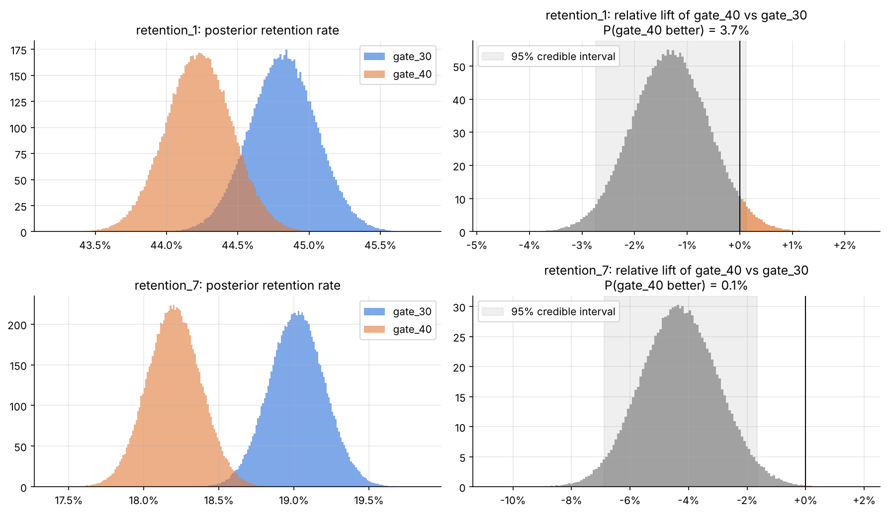
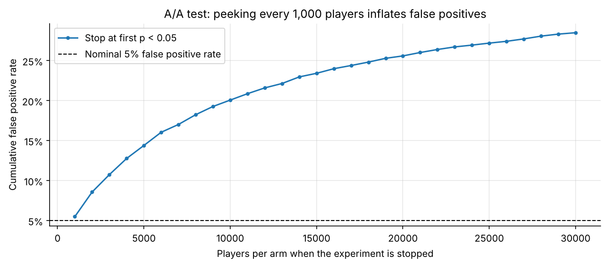

# Bayesian A/B Testing: Cookie Cats Gate Placement

> **Recommendation: keep the gate at level 30.** There is a ~99.9% probability that moving it to level 40 lowers 7-day retention, by about 0.8 percentage points (−4.3% relative, 95% credible interval −6.9% to −1.7%). Keeping level 30 carries essentially zero expected loss.

<!-- After the first push, replace USER/REPO with the repository path -->
[](https://colab.research.google.com/github/USER/REPO/blob/main/code/Cookie_Cat.ipynb)

## Introduction

**Question.** In the mobile game *Cookie Cats*, players hit a gate that makes them wait or pay to keep playing. The gate sat at **level 30**, and the team tested moving it to **level 40**. Should they ship the change?

**Data.** 90,189 players randomly assigned at install to `gate_30` (control, A) or `gate_40` (treatment, B). For each player the dataset records:

| column | meaning |
|---|---|
| `retention_1` | came back 1 day after install |
| `retention_7` | came back 7 days after install |
| `sum_gamerounds` | game rounds played in the first 14 days |

**Approach.** Data checks (including a sample ratio mismatch test) → exploratory analysis → frequentist two-proportion z-tests → Bayesian Beta-Binomial model (P(B > A), lift credible intervals, expected loss) → prior sensitivity → engagement via a Bayesian bootstrap → Monte Carlo simulation of peeking and sequential stopping.

## Results

| metric | gate_30 | gate_40 | P(gate_40 better) | expected loss if we ship gate_40 | frequentist p-value |
|---|---|---|---|---|---|
| Day-1 retention | 44.8% | 44.2% | 3.7% | 0.60 pp | 0.074 |
| Day-7 retention | 19.0% | 18.2% | 0.1% | 0.82 pp | 0.0016 |
| Mean game rounds (14 days) | 51.3 | 51.3 | 46% | n/a | 0.051 (Mann-Whitney) |



* **Frequentist vs. Bayesian framing.** Day-1 retention is not significant at α = 0.05 (p = 0.074), yet the posterior gives a 96% chance that level 30 is better. The Bayesian output (probability of being better plus expected loss) maps directly onto the ship / don't-ship decision.
* **Prior sensitivity.** With ~45k players per arm, flat, Jeffreys and weakly informative priors give practically identical results. A strong skeptical prior worth 10,000 pseudo-players per arm only shrinks the day-7 lift from −4.3% to −3.5%.
* **Engagement.** Mean game rounds are essentially identical between arms. The median is one round lower under `gate_40` (17 vs 16), so engagement does not offset the retention loss.
* **Peeking simulation.** Checking a z-test every 1,000 players and stopping at the first p < 0.05 raised the A/A false positive rate from 5.5% to **28.5%**. An expected-loss stopping rule (ε = 0.02 pp) detected a true 1 pp drop after **~7,300 players per arm on average vs. ~23,700** for a fixed-horizon test with 80% power (about 70% fewer), and picked the worse arm under 2% of the time.



## Conclusion

**Keep the gate at level 30. Do not ship `gate_40`.**

* There is a ~99.9% probability that moving the gate to level 40 lowers 7-day retention, by about 0.8 pp (−4.3% relative).
* Keeping level 30 has an expected loss of essentially zero, far below the 0.1 pp threshold of caring set before the decision.
* The result holds under every prior tested and agrees with the frequentist test.
* Engagement in the first 14 days does not change enough to offset the retention loss.

**Caveats**
1. **Sample ratio mismatch.** The group sizes (44,700 vs 45,489) fail an SRM check (p = 0.0086). In production I would investigate the assignment and logging pipeline before treating the result as final.
2. **Dilution.** About 63% of players played fewer than 30 rounds and never reached either gate, so the measured effect understates the effect on players who do reach it.
3. **Monetization is missing.** The gate is also a paywall, and the dataset has no revenue column. A complete decision would include revenue per user.

## Methods

1. **Data checks:** duplicates, missing values, removal of one outlier (a player with ~50,000 rounds), and a chi-square SRM test.
2. **Frequentist baseline:** two-proportion z-tests with 95% confidence intervals; Mann-Whitney U for game rounds.
3. **Bayesian Beta-Binomial model:** conjugate posteriors, Monte Carlo estimates (200,000 draws) of P(B > A), absolute and relative lift credible intervals, and expected loss with a pre-set threshold of caring.
4. **Prior sensitivity:** four priors (uniform, Jeffreys, Beta(20, 80), Beta(2000, 8000)), on the full data and on a random 500 players per arm.
5. **Engagement:** Bayesian bootstrap (Rubin, 1981) for the mean and median of game rounds.
6. **Sequential testing simulation:** 4,000 simulated experiments for each of three scenarios (no difference, 0.5 pp drop, 1 pp drop), comparing a single fixed-horizon test, repeated peeking, and expected-loss stopping at four thresholds.

## Repository layout

```
├── README.md
├── code/
│   ├── Cookie_Cat.ipynb   full analysis (Colab notebook)
│   └── bayes_ab.py        reusable functions: z-test, Beta-Binomial test, Bayesian bootstrap
├── data/
│   └── cookie_cats.csv    raw Kaggle data
├── figures/               the 5 plots from the notebook
└── results/               summary tables (CSV)
```

## Run it

Open `code/Cookie_Cat.ipynb` in Google Colab and click **Runtime → Run all**. The notebook mounts Google Drive and saves the data, figures and tables to `MyDrive/cookie-cats-bayesian-ab/`. It needs only `numpy`, `pandas`, `scipy` and `matplotlib`, which Colab preinstalls, and runs in under a minute.

To reuse the test on your own numbers:

```python
from bayes_ab import bayesian_ab
summary, _ = bayesian_ab(x_a=200, n_a=1000, x_b=230, n_b=1000)
print(summary["prob_B_better"], summary["loss_choose_B"])
```

## Data

[Mobile Games A/B Testing (Cookie Cats)](https://www.kaggle.com/datasets/yufengsui/mobile-games-ab-testing) on Kaggle.
